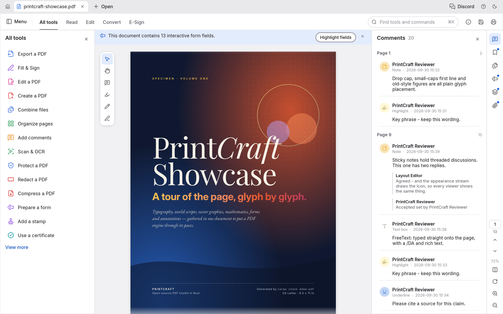

## Versão portátil para Windows 11 (x64)

- **Pelo GitHub:** aba *Actions* → *Portable Windows x64* → *Run workflow*. Ao terminar, baixe o artefato
  `PDF-PRO-Willian-portable-win11-x64` (um `.zip` com a pasta `PDF PRO Willian`). Ao criar uma tag `v*`, o
  mesmo `.zip` é anexado à release.
- **No seu PC:** com Rust (MSVC), Build Tools do Visual Studio (C++) e NASM instalados, rode
  `pwsh packaging\windows\build-portable-willian.ps1`. A pasta pronta sai em `dist\PDF PRO Willian\`.

Basta descompactar e abrir `PDF PRO Willian.exe`. O arquivo `portable.txt` ao lado do `.exe` mantém
configurações e logs na pasta `PdfCraftData`, sem escrever em `%APPDATA%`.

 

  
   
  The PdfCraft Showcase, a 13-page specimen PDF, open with the All tools panel and threaded comments.

